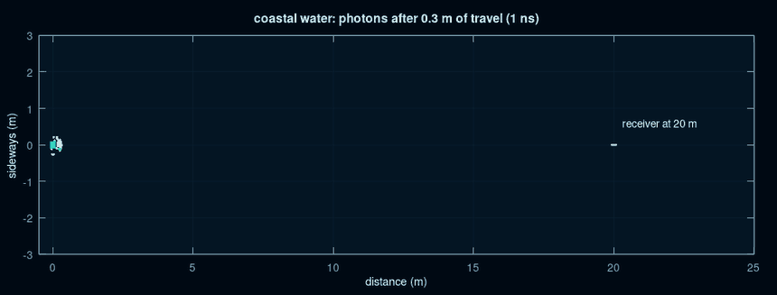
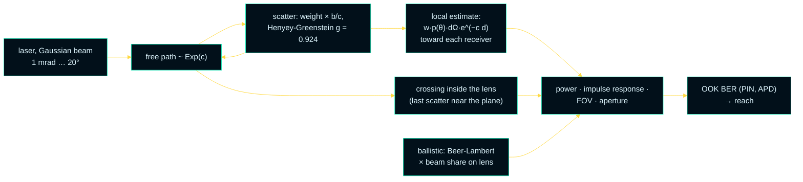
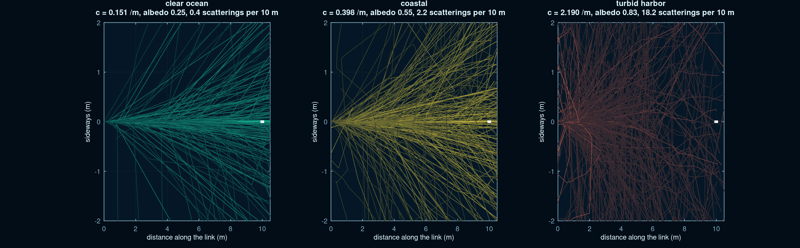
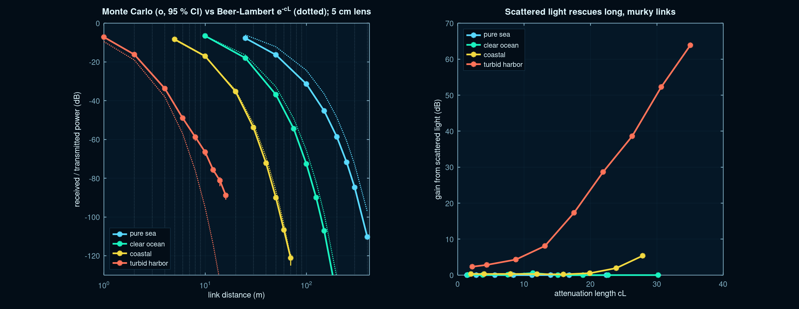
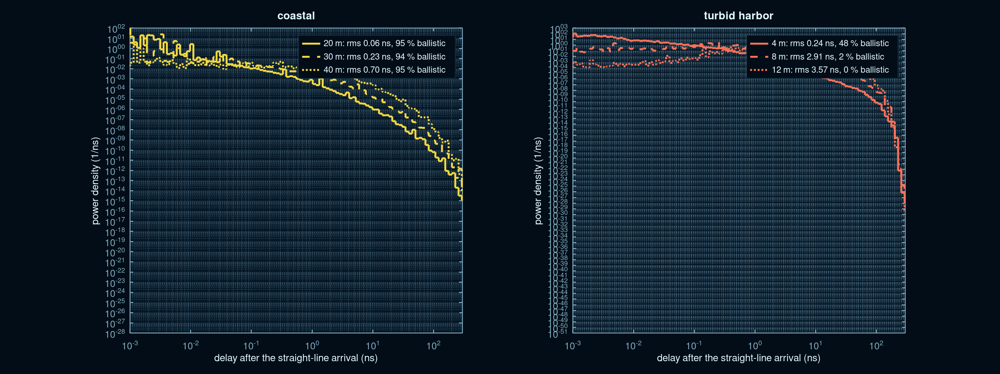
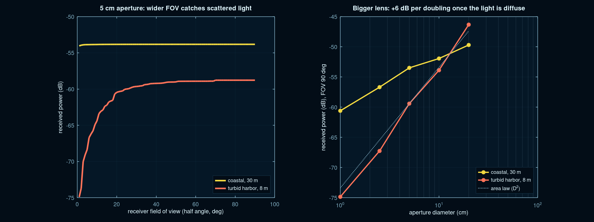
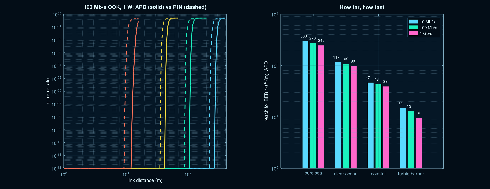
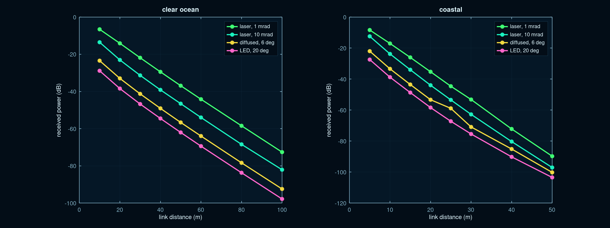

<p align="center"></p>

<p align="center">


</p>

<h3 align="center">Radio dies within metres in sea water and sound is slow. Blue-green light can carry hundreds of megabits,<br>but every particle in the water knocks photons off course. How far does the light really get?</h3>

**Underwater optical wireless communication (UWOC)** links divers, robots, sensor nodes and submarines with lasers or LEDs in the 450–550 nm window, where water absorbs least. The simple model, Beer–Lambert $P = P_0 e^{-cL}$ with extinction $c = a + b$, treats every scattered photon as lost. That is wrong: most scattering in the sea is strongly forward, and many scattered photons still reach the receiver, late and from slightly off-axis.

This repository traces individual photons through four classic water types with a Monte Carlo simulation written from scratch in MATLAB. It measures received power, the impulse response, the effect of the receiver lens and field of view, and the beam divergence, then turns them into bit error rate and the reach of a real link.

<table>
<tr>
<td align="center" width="25%"><h2>+64 dB</h2><sub>received at 16 m in a turbid<br>harbour compared with<br>Beer–Lambert (cL = 35)</sub></td>
<td align="center" width="25%"><h2>300 m</h2><sub>reach of 10 Mb/s in pure sea<br>water with a 1 W laser and an<br>APD; 15 m in a harbour</sub></td>
<td align="center" width="25%"><h2>3.6 ns</h2><sub>RMS delay spread at 12 m in a<br>harbour; 0.06 ns at 20 m on<br>the coast</sub></td>
<td align="center" width="25%"><h2>+21 dB</h2><sub>for an 8× wider lens (2.5 → 20 cm)<br>in harbour water: scattered<br>light fills the aperture</sub></td>
</tr>
</table>

<p align="center"></p>
<p align="center"><sub>3000 photons in coastal water, snapshots every 0.6 m of travel (about 2.7 ns). Colour: remaining weight, log scale. The unscattered front stays tight; scattered photons spread sideways and fall behind, which is where the pulse spreading comes from.</sub></p>

---

## ≈ Run it

```matlab
>> main                          % MATLAB R2016b or newer, no toolboxes
```
```bash
octave --no-gui --eval main      # GNU Octave 6 or newer
```

About 20 minutes. Six figures go to [`figures/`](figures), the numbers to [`results/`](results) and [`results/summary.txt`](results/summary.txt). All results here come from running this code in **GNU Octave 10.3**.



## ≈ The method

| Water type | a (1/m) | b (1/m) | c (1/m) | albedo b/c |
|:--|--:|--:|--:|--:|
| pure sea | 0.053 | 0.003 | 0.056 | 0.05 |
| clear ocean | 0.114 | 0.037 | 0.151 | 0.25 |
| coastal | 0.179 | 0.219 | 0.398 | 0.55 |
| turbid harbor | 0.366 | 1.824 | 2.190 | 0.83 |

Values near 530 nm (Petzold's measurements as tabulated by Mobley, the standard set in the UWOC literature). Each photon flies an exponential distance with mean $1/c$. At each interaction its weight is multiplied by the albedo $b/c$ (absorption as weight loss) and it turns by an angle drawn from the Henyey–Greenstein phase function with $g = 0.924$ (61 % of the scattered light within 10°, 88 % within 30°). Weights below 10⁻⁴ play Russian roulette.

Received powers fall to 10⁻¹¹, far below what counting photons that hit a 5 cm lens could resolve. [`mc_local.m`](src/mc_local.m) therefore splits the light by **where each photon scattered for the last time**, three parts that never overlap:

1. **never scattered:** Beer–Lambert times the share of the Gaussian beam on the lens, computed analytically;
2. **last scattered more than 0.5 m before the receiver:** at every such event the photon sends the expected power $w\,p_{HG}(\cos\theta)\,\Delta\Omega\,e^{-cd}$ straight into the lens (the *local estimate*);
3. **last scattered within 0.5 m of the receiver:** counted when the photon actually crosses the lens, because the point-receiver formula breaks down that close.

Where plain photon counting still has enough hits, the two methods agree to within 1 dB, and each curve is run in 8 independent batches to give a 95 % confidence interval ([`mc_batches.m`](src/mc_batches.m)).

## ≈ Results

### 1 · What the photons do

<p align="center"></p>

In clear ocean water most photons cross 10 m without meeting a particle (0.4 scatterings on average). On the coast, one or two small-angle kicks. In a harbour, 18 scatterings in 10 m: the beam becomes a diffuse glow.

### 2 · Received power against distance

<p align="center"></p>

5 cm lens, 90° field of view, 1 mrad laser:

| | distance | Monte Carlo | Beer–Lambert $e^{-cL}$ | difference |
|:--|--:|--:|--:|--:|
| pure sea | 100 m | −31.4 dB | −24.3 dB | −7.0 dB (beam wider than the lens) |
| pure sea | 400 m | −110.3 dB | −97.3 dB | −13.0 dB |
| clear ocean | 50 m | −36.9 dB | −32.8 dB | −4.1 dB |
| coastal | 30 m | −53.8 dB | −51.9 dB | −2.0 dB |
| coastal | 70 m | −121.2 dB | −121.0 dB | −0.2 dB |
| turbid harbor | 4 m | −33.7 dB | −38.0 dB | **+4.3 dB** |
| turbid harbor | 8 m | −58.8 dB | −76.1 dB | **+17.3 dB** |
| turbid harbor | 16 m | −88.9 dB | −152.7 dB | **+63.9 dB** |

Beer–Lambert errs both ways. **In clear water it is too optimistic**: a 1 mrad beam is 20 cm wide at 100 m and the 5 cm lens catches only part of it, so the real loss is geometric. **In murky water it is far too pessimistic**: forward-scattered light keeps arriving long after the direct beam is gone. At 16 m in harbour water the direct beam is 153 dB down, yet 64 dB more power still arrives. In coastal water the two effects nearly cancel up to 70 m.

### 3 · Pulse spreading

<p align="center"></p>

| | 20 m coastal | 30 m coastal | 40 m coastal | 4 m harbour | 8 m harbour | 12 m harbour |
|:--|--:|--:|--:|--:|--:|--:|
| RMS delay spread | 0.06 ns | 0.23 ns | 0.70 ns | 0.24 ns | 2.9 ns | 3.6 ns |
| unscattered share of the power | 95 % | 94 % | 96 % | 48 % | 2.1 % | 0.01 % |

The coast is effectively flat (a ballistic spike, tails below 1 ns). In a harbour the light that arrives is almost all scattered, and nanoseconds of spread start to matter at gigabit rates.

### 4 · The receiver: field of view and lens size

<p align="center"></p>

* On the coast at 30 m the power arrives almost on axis: narrowing the field of view from 90° to 20° costs 0.01 dB and rejects sunlight.
* In the harbour at 8 m the scattered light arrives from a wide cone. Cutting the field of view from 90° to 20° loses 1.7 dB.
* **Lens size:** with diffuse light the power grows with the lens area. From 2.5 to 20 cm the harbour link gains **+21 dB** and the coastal link +7 dB, because there most of the power is a narrow ballistic beam that a small lens already catches.

### 5 · Bit error rate and reach

<p align="center"></p>

OOK from a 1 W laser at 520 nm; PIN (0.3 A/W) or APD (gain 30, excess noise 5.5), both with 2 pA/√Hz input noise; bandwidth 0.7 × bit rate. Pulse spreading counts as a power penalty: only the light that arrives within one bit is useful. Reach for BER 10⁻⁶:

| | PIN 10 Mb/s | PIN 1 Gb/s | **APD 10 Mb/s** | APD 100 Mb/s | **APD 1 Gb/s** |
|:--|--:|--:|--:|--:|--:|
| pure sea | 246 m | 207 m | **300 m** | 276 m | **248 m** |
| clear ocean | 97 m | 83 m | **117 m** | 109 m | **98 m** |
| coastal | 39 m | 34 m | **47 m** | 43 m | **39 m** |
| turbid harbor | 10.9 m | 8.0 m | **15.0 m** | 13.0 m | **9.7 m** |

Water type changes the reach by a factor of 20; bit rate and detector move it by 20–90 %. Near the limit, every extra 1 dB of link budget buys about 0.3 m in a harbour and 4 m in pure sea.

### 6 · Laser or LED

<p align="center"></p>

A 1 mrad laser delivers 22 to 25 dB more power than a 20° LED-like beam in clear ocean water, and 14 to 19 dB more on the coast, where scattering spreads even the laser. The price: it has to be pointed to within a fraction of a degree. A diffused beam trades power for alignment: what a moving robot or a diver can actually use.

## ≈ What is simplified

* One wavelength (around 530 nm) and the textbook Petzold water types; real water varies with depth, season and chlorophyll.
* Henyey–Greenstein with a single g; the measured Petzold phase function has a sharper forward peak and a heavier back tail.
* No sunlight background, no turbulence, no bubbles, no pointing jitter.
* The OOK model ignores ISI patterns beyond the energy-in-one-bit penalty.
* **Every number comes from GNU Octave 10.3.** No MATLAB licence was available on the build machine.

## ≈ Repository map

```
underwater-optical-wireless-montecarlo/
├── main.m                   runs everything (about 20 min)
├── src/
│   ├── water_types.m        a, b, c of four Petzold waters
│   ├── hg_sample.m          Henyey-Greenstein sampling
│   ├── rotate_dir.m         direction update after scattering
│   ├── mc_photons.m         plain Monte Carlo with plane crossings
│   ├── mc_local.m           hybrid estimator (ballistic + local + crossing)
│   ├── mc_batches.m         independent batches and confidence intervals
│   ├── mc_tracks.m          full trajectories for pictures
│   ├── detect.m, ber_ook.m  receiver
│   └── palette.m, style_axes.m, ...
├── experiments/             exp1_paths … exp6_divergence, make_frames.m
├── figures/  results/  assets/
```

## ≈ References

1. C. D. Mobley, *Light and Water: Radiative Transfer in Natural Waters*, Academic Press, 1994.
2. T. J. Petzold, "Volume scattering functions for selected ocean waters," Scripps Institution of Oceanography, SIO Ref. 72-78, 1972.
3. B. M. Cochenour, L. J. Mullen, A. E. Laux, "Characterization of the beam-spread function for underwater wireless optical communications links," *IEEE J. Oceanic Eng.*, vol. 33, no. 4, 2008.
4. S. Tang, Y. Dong, X. Zhang, "Impulse response modeling for underwater wireless optical communication links," *IEEE Trans. Commun.*, vol. 62, no. 1, 2014.
5. Z. Zeng, S. Fu, H. Zhang, Y. Dong, J. Cheng, "A survey of underwater optical wireless communications," *IEEE Commun. Surveys & Tutorials*, vol. 19, no. 1, 2017.
6. L. Wang, S. L. Jacques, L. Zheng, "MCML — Monte Carlo modeling of light transport in multi-layered tissues," *Comput. Methods Programs Biomed.*, vol. 47, 1995 (the photon-walk update used here).

## ≈ Licence

MIT © Eng. Jaafar Salim
